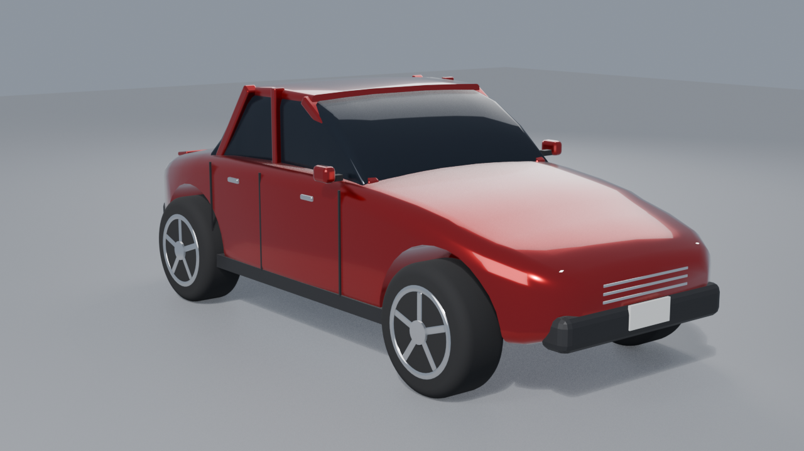

🇬🇧 **English version: [README.en.md](README.en.md)**

# Машинка в Blender

Процедурная модель машинки (классическое купе), построенная скриптом на Python
(`bpy`) в Blender 5.2 — без ручного моделирования: кузов создаётся «лофтом» из
сглаженных сечений, колёса, оптика и мелочи собираются из примитивов.



## Что внутри

| Файл | Описание |
|------|----------|
| `car.blend` | Сцена с готовой моделью, светом и камерой |
| `make_car.py` | Скрипт генерации модели и рендера |
| `car_preview.png` | Рендер превью (EEVEE, 1280×720) |
| `game.js`, `index.html` | Мини-игра на three.js |

## Особенности модели

- Кузов из 18 поперечных сечений со скруглёнными рёбрами: зауженный нос,
  нисходящий капот, ровный пояс, скатывающийся багажник
- Тонированное остекление, наклонные стойки A/C, крыша в цвет кузова
- Колёса: покрышки со скруглённым плечом, 5-спицовые диски, тормозные
  диски и суппорты
- Детали: хром-решётка, номера, зеркала, ручки, швы дверей, спойлер,
  выхлопные патроны, светящиеся фары и габариты
- Материалы: металлик с лаком (clearcoat), тонированное стекло, хром

## Как собрать заново

```bash
blender --background --python make_car.py
```

Скрипт пересоберёт `car.blend` и `car_preview.png` с нуля.

## Как посмотреть

Открой `car.blend` в Blender 5.x и нажми `F12` для рендера.

## Авторство

Проект (модель, скрипт генерации, рендер и README) создан **нейросетью**
(AI-ассистентом opencode) по запросу пользователя.
